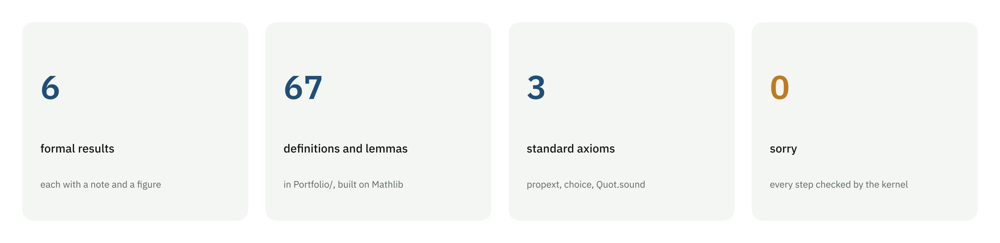
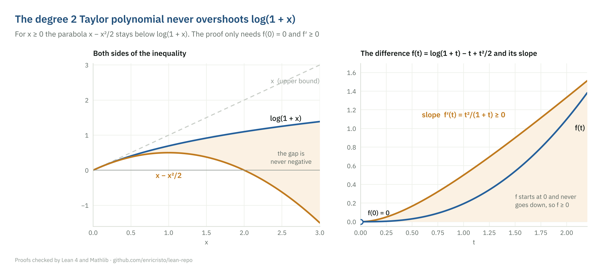
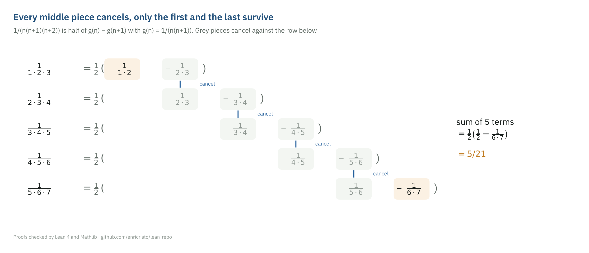
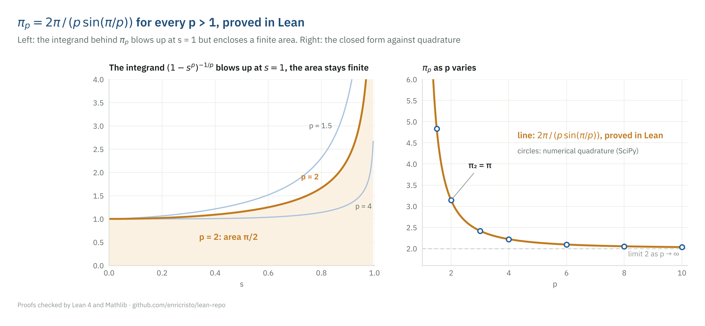
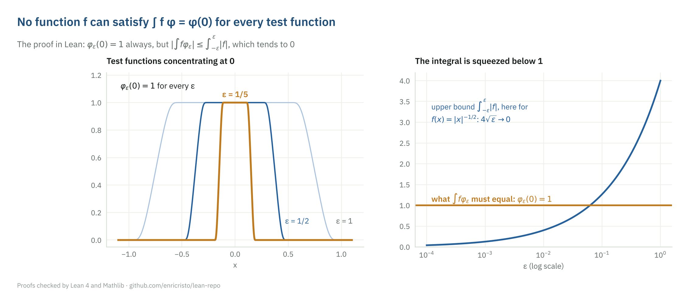
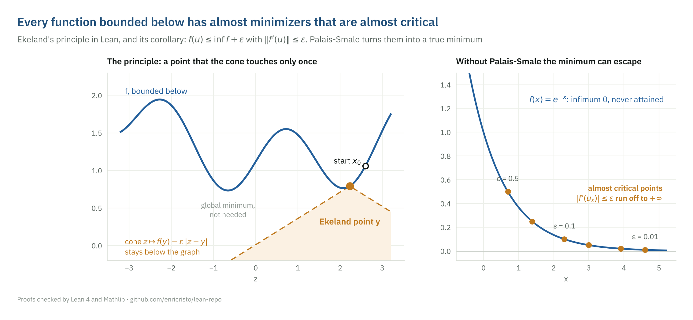

# Formal proofs in Lean 4

[](https://github.com/enricristo/lean-repo/actions/workflows/lean_action_ci.yml)

Theorems from analysis, proved in [Lean 4](https://lean-lang.org/) on top of
[Mathlib](https://github.com/leanprover-community/mathlib4). Every step is
checked by the Lean kernel: a proof that compiles is a proof that is correct,
down to the axioms. Each result comes with a short note that explains the
mathematical idea, draws it, and reads the Lean code step by step.

The track starts with classical calculus facts and moves toward the analysis
of my master's thesis on the Fučík spectrum of the $p$-Laplacian.



## Results

### 1. The Taylor polynomial of log(1 + x) never overshoots

$$\log(1+x) \;\ge\; x - \frac{x^2}{2} \qquad (x \ge 0)$$

The difference $f(t) = \log(1+t) - t + t^2/2$ starts at $0$ and its derivative
$t^2/(1+t)$ is never negative, so $f$ never goes below $0$. In Lean this is the
mean value theorem in the form "nonnegative derivative implies monotone",
which asks for continuity up to the endpoint and a derivative on the open
interior.
[Note](notes/log-lower-bound.md) · [Lean](Portfolio/Analysis/LogLowerBound.lean)



### 2. A telescoping series

$$\sum_{n=1}^{\infty} \frac{1}{n(n+1)(n+2)} = \frac{1}{4}$$

Partial fractions turn each term into half a difference of consecutive values
of $1/(n(n+1))$, and the middle pieces cancel. The Lean proof checks the
closed form $S_N = 1/4 - 1/(2(N+1)(N+2))$ by induction, squeezes the
correction to $0$, and upgrades convergence of the partial sums to Mathlib's
unconditional `HasSum` using that the terms are nonnegative.
[Note](notes/telescoping-sum.md) · [Lean](Portfolio/Series/Telescoping.lean)



### 3. π<sub>p</sub> in closed form

$$\pi_p = 2\int_0^1 \left(1-s^p\right)^{-1/p} ds = \frac{2\pi}{p\,\sin(\pi/p)} \qquad (p > 1)$$

$\pi_p$ is the constant of the generalized sine that solves the one
dimensional $p$-Laplacian eigenvalue problem: on $(0, 1)$ the first
eigenvalue is $(p-1)\pi_p^{\,p}$. The integral is improper, so the proof
avoids limits twice. For $p = 2$ it uses $\arcsin$ and the fact that a
nonnegative derivative of a bounded function is integrable. For every
$p > 1$ it substitutes $u = s^p$ through Mathlib's rule on $(0, \infty)$ with
an indicator function, lands on the Beta function $B(1/p, 1 - 1/p)$, and
finishes with Euler's reflection formula $\Gamma(z)\Gamma(1-z) = \pi/\sin(\pi z)$.
[Note](notes/pi-p.md) · [Lean](Portfolio/PLaplacian/ClosedForm.lean)



### 4. Calculus on the time scale hℤ

$$y^\Delta = c\,y,\quad y(0) = 1 \text{ on } h\mathbb{Z} \;\Longrightarrow\; y(hn) = (1 + hc)^n \;\xrightarrow[\;h \to 0\;]{}\; e^{ct}$$

A time scale is a closed subset of $\mathbb{R}$, and calculus on it treats
differential and difference equations as one theory. Mathlib has none of
it, so the file defines the forward jump $\sigma$, the graininess $\mu$ and
the delta derivative from scratch, computes them on $h\mathbb{Z}$, and proves
that the Hilger exponential is the unique solution of $y^\Delta = p\,y$. It is
strictly below the real exponential for every $h > 0$ and converges to it as
the graininess goes to $0$.
[Note](notes/time-scales.md) · [Lean](Portfolio/TimeScales/Integers.lean)


### 5. The Dirac delta is not a function

$$\nexists\, f \in L^1_{\mathrm{loc}}(\mathbb{R}^n) : \int f\,\varphi = \varphi(0) \text{ for every test function } \varphi \qquad (n \ge 1)$$

If such an $f$ existed, bumps $\varphi$ with $\varphi(0) = 1$ supported in
smaller and smaller balls would give $1 \le \int_{B_\varepsilon} |f|$, while
the right side tends to $0$ because the balls shrink to a point of measure
zero. The Lean statement uses only plain Mathlib notions, with smooth meaning
$C^\infty$: with the analytic exponent the hypothesis would be empty and the
theorem false.
[Note](notes/dirac-not-regular.md) · [Lean](Portfolio/Distributions/DiracNotRegular.lean)



### 6. Ekeland's principle and the Palais-Smale condition

$$f : E \to \mathbb{R} \text{ differentiable, bounded below} \;\Longrightarrow\; \forall \varepsilon > 0\;\, \exists\, u : \; f(u) \le \inf f + \varepsilon,\;\; \|f'(u)\| \le \varepsilon$$

On a complete metric space a lower semicontinuous function bounded below
has, near any starting point, a point $y$ that the cone
$z \mapsto f(y) - \varepsilon\,d(z, y)$ touches only once. The proof is a
Cauchy sequence of nested closed sets whose radii shrink like $2^{-n}$. On a
Banach space, differentiating the cone inequality gives almost minimizers
that are almost critical, and the Palais-Smale condition at the infimum
turns them into a true minimizer with $f'(u) = 0$. This is the compactness
mechanism behind the critical point theory of my master's thesis.
[Note](notes/ekeland.md) · [Lean](Portfolio/CriticalPoints/Ekeland.lean)



## Learning track

My solutions to the two standard introductions to Lean, kept in their own
folder and compiled with the rest of the project.

| Course | Folder | Progress |
|---|---|---|
| [Natural Number Game](https://adam.math.hhu.de/#/g/leanprover-community/nng4) | [`Solutions/NaturalNumberGame`](Solutions/NaturalNumberGame) | Tutorial World in progress |
| [Mathematics in Lean](https://leanprover-community.github.io/mathematics_in_lean/) | [`Solutions/MathematicsInLean`](Solutions/MathematicsInLean) | starts after the game |

## How the results are checked

Three independent layers:

1. **Lean.** `lake build` compiles every proof against Mathlib. No `sorry`
   anywhere.
2. **Axiom audit.** [`Test/Axioms.lean`](Test/Axioms.lean) pins the axioms
   each main theorem depends on: `propext`, `Classical.choice` and
   `Quot.sound`, the standard ones. An unfinished proof would add `sorryAx`
   and break the build.
3. **SymPy and SciPy.** [`tests/test_identities.py`](tests/test_identities.py) redoes
   every algebraic identity used in the proofs in a second system and
   recomputes the numbers shown in the figures.

GitHub Actions runs all three on every push.

## Repository layout

| Path | Content |
|---|---|
| [`Portfolio/`](Portfolio/) | Formal results, one file per result |
| [`notes/`](notes/) | One note per result: idea, figure, proof map, Lean walkthrough |
| [`Solutions/`](Solutions/) | Natural Number Game and Mathematics in Lean |
| [`Test/`](Test/) | Axiom audit |
| [`tests/`](tests/) | SymPy checks of the identities and of the quoted numbers |
| [`figures/`](figures/) | Every figure here, regenerated by `scripts/make_figures.py` |

## Running it

```bash
# Lean (install elan first: https://github.com/leanprover/elan)
lake exe cache get              # precompiled Mathlib, a few minutes
lake build                      # proofs, solutions and axiom audit

# Python
pip install -r requirements.txt
pytest                          # SymPy and SciPy checks
python scripts/make_figures.py  # regenerates figures/
```

The Lean version is pinned in `lean-toolchain` and the Mathlib version in
`lakefile.toml`.

## References

- The Mathlib Community, *The Lean mathematical library*, CPP 2020.
- J. Avigad and P. Massot, *Mathematics in Lean*.
- K. Buzzard and M. Pedramfar, *Natural Number Game*.
- P. Lindqvist, *Some remarkable sine and cosine functions*, Ricerche di Matematica 44 (1995).
- I. Ekeland, *On the variational principle*, J. Math. Anal. Appl. 47 (1974).
- M. Bohner and A. Peterson, *Dynamic Equations on Time Scales*, Birkhäuser, 2001.

## Author

Enrico Sonvenso Ambrosio · M.Sc. in Mathematics (UNESP), agronomy student
(Unoeste), researcher at LSNIA, FCT/UNESP ·
[ORCID 0000-0002-6674-3689](https://orcid.org/0000-0002-6674-3689) ·
[LinkedIn](https://www.linkedin.com/in/enricoambrosio) ·
[hilum.science](https://hilum.science/en/)

Code under the Apache License 2.0, the same license as Mathlib. IBM Plex Sans
is bundled under the SIL Open Font License
([`scripts/fonts/OFL.txt`](scripts/fonts/OFL.txt)).
