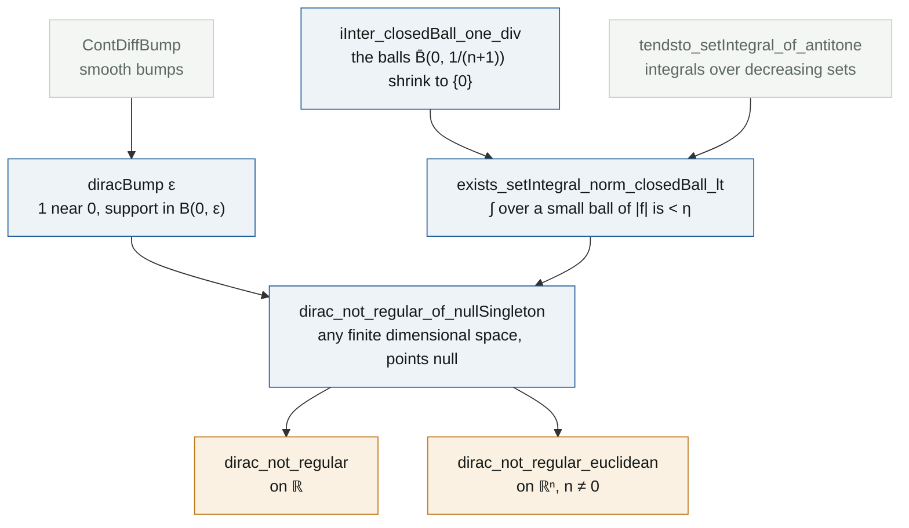

# The Dirac delta is not a regular distribution

**Lean file:** [`Portfolio/Distributions/DiracNotRegular.lean`](../Portfolio/Distributions/DiracNotRegular.lean) ·
**Main theorems:** `Portfolio.dirac_not_regular`, `Portfolio.dirac_not_regular_euclidean`


## Statement

There is no locally integrable $f : \mathbb{R} \to \mathbb{R}$ such that

$$\int_{\mathbb{R}} f(x)\,\varphi(x)\,dx = \varphi(0)$$

for every smooth, compactly supported test function $\varphi$. The same holds on $\mathbb{R}^n$ for every $n \ge 1$. In the language of distributions: $\delta$ is not regular. This was a question in my PDE exam (2021).

The Lean statement uses only plain Mathlib notions, so it can be checked without any theory of distributions:

```lean
theorem dirac_not_regular :
    ¬ ∃ f : ℝ → ℝ, LocallyIntegrable f ∧
      ∀ φ : ℝ → ℝ, ContDiff ℝ ∞ φ → HasCompactSupport φ → ∫ x, f x * φ x = φ 0
```

## The idea

Suppose such an $f$ exists. Take bumps $\varphi_\varepsilon$ with $\varphi_\varepsilon(0) = 1$, $0 \le \varphi_\varepsilon \le 1$, supported in $(-\varepsilon, \varepsilon)$ (left panel). Then

$$1 = \varphi_\varepsilon(0) = \int f\,\varphi_\varepsilon \;\le\; \int_{-\varepsilon}^{\varepsilon} |f|.$$

Since $f$ is integrable near $0$, the right side tends to $0$ as $\varepsilon \to 0$, because the intervals shrink to the single point $\{0\}$, which has measure zero. Eventually it drops below $1$: contradiction. The right panel shows the mechanism for $f(x) = |x|^{-1/2}$, which is unbounded but locally integrable: the bound $4\sqrt\varepsilon$ falls under the line $1$.

## Proof map



## Reading the Lean proof

**Smooth means $C^\infty$, not analytic.** In current Mathlib, smoothness exponents live in `WithTop ℕ∞`, whose top element `ω` means *analytic*. The statement uses `∞`, which is $C^\infty$. This is not pedantry: an analytic function with compact support is identically zero, so with `ω` the hypothesis would be satisfied by $f = 0$ and the theorem would be false.

**The bumps.** Mathlib's `ContDiffBump` gives a smooth function equal to $1$ on a closed ball and supported in a larger open ball. `diracBump ε` uses radii $\varepsilon/2$ and $\varepsilon$; `diracBump_real` records that on $\mathbb{R}$ it equals $1$ at $0$ and has support exactly $(-\varepsilon, \varepsilon)$.

**Small integrals near a point.** Instead of an $\varepsilon$ argument, `exists_setIntegral_norm_closedBall_lt` uses continuity of the integral along decreasing sets (`tendsto_setIntegral_of_antitone`): the balls $\bar B(0, 1/(n+1))$ decrease to $\{0\}$, the integral over $\{0\}$ is $0$, so the integrals eventually fall below any $\eta > 0$. Local integrability enters exactly once, to know that $|f|$ is integrable on the first ball, which is compact.

**The contradiction.** Outside the ball $f\varphi$ vanishes, so the whole integral equals the integral over the ball, which is at most $\int_{\bar B}|f| < 1$ because $0 \le \varphi \le 1$; yet it equals $1$.

**Generality for free.** The argument never uses that the space is $\mathbb{R}$: it works in any finite dimensional real normed space with a measure that gives points measure zero. The version on $\mathbb{R}^n$ needs $n \ne 0$, and the hypothesis is sharp: $\mathbb{R}^0$ is a single point with counting measure, where $f = 1$ does represent $\delta$.

## Independent checks

[`tests/test_identities.py`](../tests/test_identities.py) checks the mechanism on $f(x) = |x|^{-1/2}$: $\int_{-r}^{r}|x|^{-1/2}dx = 4\sqrt r$, which is below $1$ for $r = 0.01$. [`Test/Axioms.lean`](../Test/Axioms.lean) audits both main theorems.
