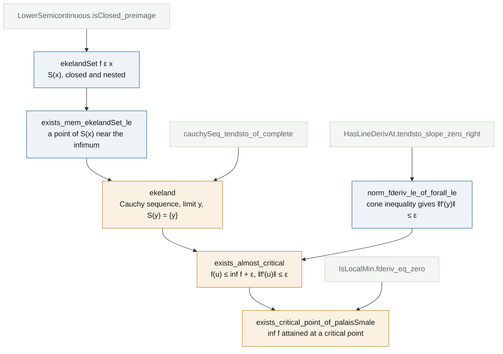

# Ekeland's variational principle and critical points

**Lean file:** [`Portfolio/CriticalPoints/Ekeland.lean`](../Portfolio/CriticalPoints/Ekeland.lean) ·
**Main theorems:** `Portfolio.ekeland`, `Portfolio.exists_almost_critical`, `Portfolio.exists_critical_point_of_palaisSmale`

## Why this result

In the variational approach to a PDE, a solution is a critical point of an energy functional on an infinite dimensional space. A functional bounded below has an infimum, but in infinite dimensions there is no compactness to make a minimizing sequence converge. Ekeland's principle (1974) gives the next best thing: minimizing sequences that are also *almost critical*. The Palais-Smale condition then supplies exactly the compactness that is missing. This is the starting point of the critical point theory in my master's thesis, where the same condition drives the mountain pass theorem.

## Statements

**1. Ekeland's principle (strong form).** Let $X$ be a complete metric space, $f : X \to \mathbb{R}$ lower semicontinuous and bounded below, $\varepsilon > 0$ and $x_0 \in X$. There is $y \in X$ with

$$f(y) + \varepsilon\,d(x_0, y) \le f(x_0) \qquad\text{and}\qquad f(y) < f(z) + \varepsilon\,d(z, y) \text{ for every } z \ne y.$$

The second condition says that the cone $z \mapsto f(y) - \varepsilon\,d(z, y)$ lies below the graph of $f$ and touches it only at $y$ (left panel).

**2. Almost critical points.** Let $E$ be a real Banach space and $f : E \to \mathbb{R}$ differentiable and bounded below. For every $\varepsilon > 0$ there is $u$ with

$$f(u) \le \inf f + \varepsilon \qquad\text{and}\qquad \|f'(u)\| \le \varepsilon.$$

**3. Palais-Smale at the infimum.** If moreover every sequence with $f(u_n) \to \inf f$ and $f'(u_n) \to 0$ has a convergent subsequence, then $\inf f$ is attained at a point $u$ with $f'(u) = 0$.

The right panel shows why the hypothesis in 3 matters. For $f(x) = e^{-x}$ the almost critical points of 2 are $u_\varepsilon = \log(1/\varepsilon)$: they exist, but they run off to infinity, and the infimum $0$ is never attained.

## The idea of the proof of 1

For each $x$ consider the set of points that do at least as well once the cone is taken into account:

$$S(x) = \{z : f(z) + \varepsilon\,d(z, x) \le f(x)\}.$$

It contains $x$, it is closed because $f$ is lower semicontinuous, and by the triangle inequality $z \in S(x)$ implies $S(z) \subseteq S(x)$. Start at $x_0$ and choose $x_{n+1} \in S(x_n)$ whose value is within $2^{-n}$ of the infimum of $f$ on $S(x_n)$. Any $z \in S(x_{n+1})$ then satisfies

$$\varepsilon\,d(z, x_{n+1}) \le f(x_{n+1}) - f(z) \le 2^{-n},$$

so the nested sets $S(x_n)$ have radii that go to $0$. The sequence is Cauchy, its limit $y$ lies in every $S(x_n)$, and any $z$ in $S(y)$ is squeezed together with $y$ into balls of radius $2^{-n}/\varepsilon$, so $z = y$.

## From 1 to 2 and 3

For 2, start Ekeland at a point $x_0$ with $f(x_0) < \inf f + \varepsilon$. The point $y$ satisfies $f(y) \le f(y + tv) + \varepsilon t\|v\|$ for every direction $v$ and $t > 0$. Divide by $t$ and let $t \to 0^+$: $f'(y)v \ge -\varepsilon\|v\|$. The same with $-v$ gives $|f'(y)v| \le \varepsilon\|v\|$, which is $\|f'(y)\| \le \varepsilon$.

For 3, take $\varepsilon = 1/(n+1)$ in 2. The resulting sequence is exactly a Palais-Smale sequence at the level $\inf f$, so a subsequence converges to some $u_0$. By continuity $f(u_0) = \inf f$, so $u_0$ is a global minimizer and Fermat's rule gives $f'(u_0) = 0$.

## Proof map

## Reading the Lean proof

**Choosing the sequence.** `choose` turns the existence statement `exists_mem_ekelandSet_le` into a function `next n x`, and the sequence is defined by plain recursion, `x 0 = x₀` and `x (n + 1) = next n (x n)`, so that `x (n + 1) = next n (x n)` holds by `rfl`. Nesting of the sets along the sequence is `Nat.le_induction`.

**Closedness.** $z \mapsto f(z) + \varepsilon\,d(z, x)$ is lower semicontinuous as a sum of a lower semicontinuous and a continuous function, and a sublevel set of a lower semicontinuous function is closed. This is the only place where the hypothesis on $f$ is used, and it is what lets the limit $y$ inherit membership in every $S(x_n)$ through `IsClosed.mem_of_tendsto`.

**The derivative bound.** Mathlib's `HasLineDerivAt.tendsto_slope_zero_right` gives the one sided difference quotients $t^{-1}(f(y + tv) - f(y)) \to f'(y)v$ as $t \to 0^+$, and `ge_of_tendsto` passes the inequality to the limit. The operator norm bound is `ContinuousLinearMap.opNorm_le_bound`.

**No $C^1$ needed.** Statement 3 asks only for differentiability. The point produced by Palais-Smale is a global minimizer, and Fermat's rule `IsLocalMin.fderiv_eq_zero` needs nothing more. Continuity of the derivative becomes necessary only for minimax levels such as the mountain pass, where the critical point is not a minimum.

## Independent checks

[`tests/test_identities.py`](../tests/test_identities.py) checks the two properties of the Ekeland point drawn in the left panel on a fine grid, and that the almost critical points of $e^{-x}$ satisfy both inequalities of statement 2 while escaping to infinity. [`Test/Axioms.lean`](../Test/Axioms.lean) audits the three main theorems.

## References

- I. Ekeland, *On the variational principle*, J. Math. Anal. Appl. 47 (1974), 324 to 353.
- D. G. de Figueiredo, *Lectures on the Ekeland Variational Principle with Applications and Detours*, Tata Institute, 1989.
