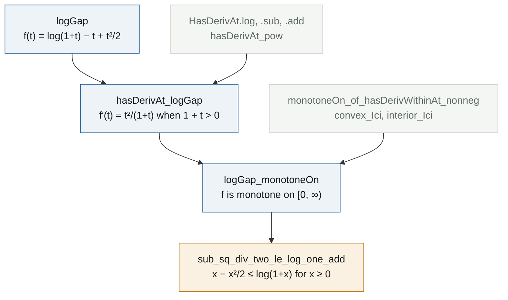

# A lower bound for log(1 + x)

**Lean file:** [`Portfolio/Analysis/LogLowerBound.lean`](../Portfolio/Analysis/LogLowerBound.lean) ·
**Main theorem:** `Portfolio.sub_sq_div_two_le_log_one_add`


## Statement

For every real $x \ge 0$,

$$\log(1+x) \;\ge\; x - \frac{x^2}{2}.$$

The right hand side is the Taylor polynomial of degree 2 of $\log(1+x)$ at $0$. The inequality says that this truncation never overshoots on $[0, \infty)$. Together with the classical $\log(1+x) \le x$ it traps the logarithm between a line and a parabola (left panel).

## The idea

Put everything on one side:

$$f(t) = \log(1+t) - t + \frac{t^2}{2}.$$

Two facts finish the proof (right panel).

1. **It starts at zero.** $f(0) = \log 1 = 0$.
2. **It never goes down.** $f'(t) = \dfrac{1}{1+t} - 1 + t = \dfrac{t^2}{1+t} \ge 0$ for $t \ge 0$.

A function that starts at $0$ and never decreases stays $\ge 0$, so $f(x) \ge 0$, which is the inequality.

## Proof map

Each box is one declaration in the Lean file. Grey boxes are lemmas taken from Mathlib.



## Reading the Lean proof

**Step 1. The derivative.** Mathlib builds derivatives the way one does by hand, one rule at a time.

```lean
have hlog : HasDerivAt (fun s ↦ Real.log (1 + s)) (1 / (1 + t)) t := by
  simpa using ((hasDerivAt_id t).const_add 1).log ht.ne'
```

`hasDerivAt_id t` says the identity has derivative $1$. `.const_add 1` turns it into $s \mapsto 1 + s$, and `.log` applies the chain rule for the logarithm. That last step needs $1 + t \ne 0$, which is `ht.ne'`. The same pattern gives the derivatives of $t$ and $t^2/2$, and `.sub`, `.add` combine the three.

The rules produce the derivative in the shape $\frac{1}{1+t} - 1 + t$. To match the shape $\frac{t^2}{1+t}$ in the statement, one line of algebra is checked separately:

```lean
have hval : t ^ 2 / (1 + t) = 1 / (1 + t) - 1 + t := by
  field_simp
  ring
```

`field_simp` clears the denominators (it finds $1 + t \ne 0$ in the context) and `ring` proves the polynomial identity that is left.

**Step 2. Monotonicity.** The Mathlib lemma `monotoneOn_of_hasDerivWithinAt_nonneg` is the mean value theorem in the form "nonnegative derivative implies monotone". It asks for three things, which are exactly the three bullets of the proof:

```lean
apply monotoneOn_of_hasDerivWithinAt_nonneg (convex_Ici 0) (f' := fun t ↦ t ^ 2 / (1 + t))
· -- f is continuous on [0, ∞)
· -- f has derivative f' at every point of the interior (0, ∞)
· -- f' ≥ 0 on the interior
```

`convex_Ici 0` records that $[0, \infty)$ is an interval, and `interior_Ici` rewrites its interior as $(0, \infty)$.

**Step 3. Conclusion.** Monotonicity applied to $0 \le x$ gives $f(0) \le f(x)$. After `simp` replaces $\log 1$ by $0$, the goal is a linear inequality between the two sides, closed by `linarith`.

## What the formalization makes explicit

On paper "$f' \ge 0$, so $f$ is increasing" feels like one step. Lean asks on which set, insists on continuity up to the endpoint $0$, and only needs the derivative on the open interior. The hypothesis $1 + t > 0$, which keeps the logarithm differentiable, also has to be carried along by hand. None of this is hard, but none of it can be skipped.

## Independent checks

[`tests/test_identities.py`](../tests/test_identities.py) redoes the derivative and the identity `hval` in SymPy and tests the inequality on 200,001 points of $[0, 50]$. [`Test/Axioms.lean`](../Test/Axioms.lean) confirms that the theorem uses only the three standard axioms.
