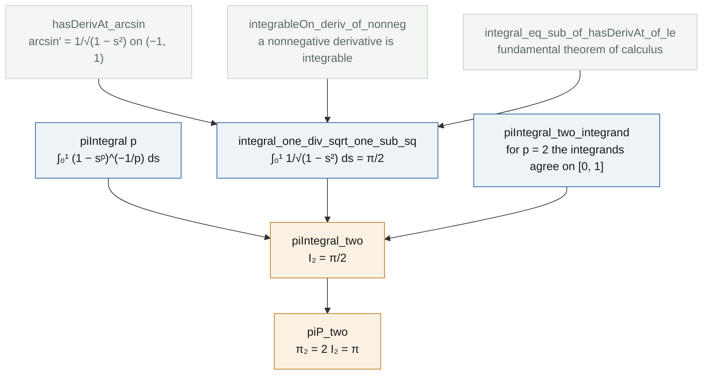

# π_p, and why π_2 = π

**Lean file:** [`Portfolio/PLaplacian/PiP.lean`](../Portfolio/PLaplacian/PiP.lean) ·
**Main theorems:** `Portfolio.piIntegral_two`, `Portfolio.piP_two` · **Status:** the case $p = 2$ is proved; the general closed form is next


## Where π_p comes from

For $p > 1$, the one dimensional $p$-Laplacian eigenvalue problem

$$-\left(|u'|^{p-2}u'\right)' = \lambda\,|u|^{p-2}u$$

is solved by a *generalized sine* $\sin_p$. Its inverse is written with an integral, exactly as $\arcsin x = \int_0^x (1-s^2)^{-1/2}\,ds$:

$$\arcsin_p x = \int_0^x \left(1-s^p\right)^{-1/p} ds, \qquad 0 \le x \le 1.$$

The value at $x = 1$ is a quarter period of $\sin_p$, and the constant $\pi_p$ is twice it:

$$I_p = \int_0^1 \left(1-s^p\right)^{-1/p} ds, \qquad \pi_p = 2 I_p.$$

This is Lindqvist's normalization. With it, $u(x) = \sin_p(\pi_p x)$ is the first eigenfunction on $(0, 1)$ with zero boundary values, and the first eigenvalue is

$$\lambda_1 = (p-1)\,\pi_p^{\,p}.$$

Some authors absorb the factor $(p-1)^{1/p}$ into $\pi_p$ so that $\lambda_1 = \pi_p^{\,p}$; the two conventions differ only by that factor. For $p = 2$ we get back $\sin$, $\arcsin$, $\pi$ and $\lambda_1 = \pi^2$.

## What is proved so far

$$I_2 = \int_0^1 \frac{ds}{\sqrt{1-s^2}} = \frac{\pi}{2}, \qquad \text{hence} \qquad \pi_2 = \pi.$$

The interesting part is that this integral is **improper**: the integrand blows up at $s = 1$ (left panel). On paper one writes $\lim_{b \to 1^-} \arcsin b$; the formal proof avoids that limit altogether.

## Proof map



## Reading the Lean proof

**Step 1. Integrability without computing a limit.** The fundamental theorem of calculus in Mathlib asks for three things: $F$ continuous on $[a, b]$, $F' = f$ on the open interval $(a, b)$, and $f$ integrable. With $F = \arcsin$ the first two are standard, and they only need the open interval, where the derivative exists. The third is the delicate one, because $f$ is unbounded near $1$. Mathlib has a lemma that settles it for free:

```lean
have hint : IntervalIntegrable (fun s : ℝ ↦ 1 / √(1 - s ^ 2)) volume 0 1 := by
  rw [intervalIntegrable_iff_integrableOn_Ioc_of_le zero_le_one]
  exact integrableOn_deriv_of_nonneg hcont hderiv (fun x _ ↦ by positivity)
```

`integrableOn_deriv_of_nonneg` says: if $F$ is continuous on $[a, b]$ and its derivative is nonnegative on $(a, b)$, then that derivative is integrable. The idea is that the integral of a nonnegative derivative is controlled by $F(b) - F(a)$, which is finite. So the improper integral converges because $\arcsin$ is bounded, and no $\varepsilon$ or limit ever appears.

**Step 2. The fundamental theorem of calculus.**

```lean
rw [integral_eq_sub_of_hasDerivAt_of_le zero_le_one hcont hderiv hint, arcsin_one, arcsin_zero,
  sub_zero]
```

The integral becomes $\arcsin 1 - \arcsin 0 = \pi/2 - 0$.

**Step 3. Matching the general definition.** `piIntegral p` uses real powers `s ^ p` and `(⋯) ^ (-(1 / p))`, which in Lean are `Real.rpow` and are defined for every real exponent. For $p = 2$ the lemma `piIntegral_two_integrand` rewrites $s^{(2 : \mathbb{R})}$ as $s^2$ (`rpow_two`), a negative exponent as an inverse (`rpow_neg`), and the power $1/2$ as a square root (`sqrt_eq_rpow`). The two integrands then agree on all of $[0, 1]$, endpoint included, and `integral_congr` transfers the value. Finally `piP_two` is one line: $\pi_2 = 2 \cdot \pi/2 = \pi$.

## What comes next

The closed form for every $p > 1$:

$$I_p = \frac{\pi}{p \sin(\pi/p)}.$$

The plan in Lean has three steps: the substitution $u = s^p$ turns $I_p$ into $\frac{1}{p}B\!\left(\frac{1}{p}, 1 - \frac{1}{p}\right)$; Mathlib's `Gamma_mul_Gamma_eq_betaIntegral` writes the Beta function with Gamma functions; and Euler's reflection formula `Real.Gamma_mul_Gamma_one_sub` gives $\Gamma(z)\Gamma(1-z) = \pi / \sin(\pi z)$. The right panel of the figure already checks this formula numerically.

## Independent checks

[`tests/test_identities.py`](../tests/test_identities.py) computes $I_2 = \pi/2$ symbolically in SymPy, checks $\arcsin' = 1/\sqrt{1-s^2}$, and compares numerical quadrature of $I_p$ with $\pi/(p\sin(\pi/p))$ for eight values of $p$, to $10^{-7}$. [`Test/Axioms.lean`](../Test/Axioms.lean) confirms that `piIntegral_two` and `piP_two` use only the three standard axioms.

## Reference

P. Lindqvist, *Some remarkable sine and cosine functions*, Ricerche di Matematica 44 (1995), 269 to 290.
