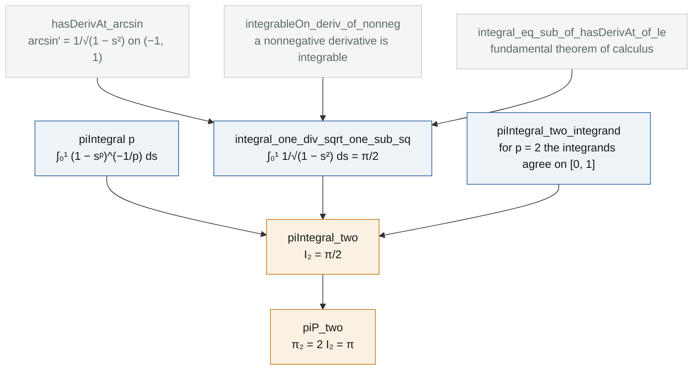
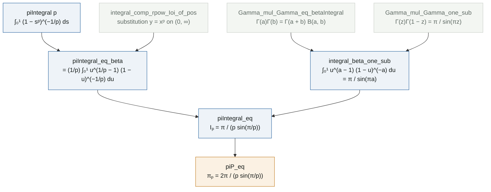

# π_p in closed form

**Lean files:** [`Portfolio/PLaplacian/PiP.lean`](../Portfolio/PLaplacian/PiP.lean) (definition, case $p = 2$) ·
[`Portfolio/PLaplacian/ClosedForm.lean`](../Portfolio/PLaplacian/ClosedForm.lean) (every $p > 1$) ·
**Main theorems:** `Portfolio.piP_eq`, `Portfolio.piIntegral_eq`, `Portfolio.piP_two`

$$\pi_p = 2\int_0^1 \left(1-s^p\right)^{-1/p} ds = \frac{2\pi}{p\,\sin(\pi/p)} \qquad (p > 1).$$


## Where π_p comes from

For $p > 1$, the one dimensional $p$-Laplacian eigenvalue problem

$$-\left(|u'|^{p-2}u'\right)' = \lambda\,|u|^{p-2}u$$

is solved by a *generalized sine* $\sin_p$. Its inverse is written with an integral, exactly as $\arcsin x = \int_0^x (1-s^2)^{-1/2}\,ds$:

$$\arcsin_p x = \int_0^x \left(1-s^p\right)^{-1/p} ds, \qquad 0 \le x \le 1.$$

The value at $x = 1$ is a quarter period of $\sin_p$, and the constant $\pi_p$ is twice it:

$$I_p = \int_0^1 \left(1-s^p\right)^{-1/p} ds, \qquad \pi_p = 2 I_p.$$

This is Lindqvist's normalization. With it, $u(x) = \sin_p(\pi_p x)$ is the first eigenfunction on $(0, 1)$ with zero boundary values, and the first eigenvalue is

$$\lambda_1 = (p-1)\,\pi_p^{\,p}.$$

Some authors absorb the factor $(p-1)^{1/p}$ into $\pi_p$ so that $\lambda_1 = \pi_p^{\,p}$; the two conventions differ only by that factor. For $p = 2$ we get back $\sin$, $\arcsin$, $\pi$ and $\lambda_1 = \pi^2$.

## Part 1, warm-up: the case p = 2

$$I_2 = \int_0^1 \frac{ds}{\sqrt{1-s^2}} = \frac{\pi}{2}, \qquad \text{hence} \qquad \pi_2 = \pi.$$

The interesting part is that this integral is **improper**: the integrand blows up at $s = 1$ (left panel). On paper one writes $\lim_{b \to 1^-} \arcsin b$; the formal proof avoids that limit altogether.

### Proof map



### Reading the Lean proof

**Step 1. Integrability without computing a limit.** The fundamental theorem of calculus in Mathlib asks for three things: $F$ continuous on $[a, b]$, $F' = f$ on the open interval $(a, b)$, and $f$ integrable. With $F = \arcsin$ the first two are standard, and they only need the open interval, where the derivative exists. The third is the delicate one, because $f$ is unbounded near $1$. Mathlib has a lemma that settles it for free:

```lean
have hint : IntervalIntegrable (fun s : ℝ ↦ 1 / √(1 - s ^ 2)) volume 0 1 := by
  rw [intervalIntegrable_iff_integrableOn_Ioc_of_le zero_le_one]
  exact integrableOn_deriv_of_nonneg hcont hderiv (fun x _ ↦ by positivity)
```

`integrableOn_deriv_of_nonneg` says: if $F$ is continuous on $[a, b]$ and its derivative is nonnegative on $(a, b)$, then that derivative is integrable. The idea is that the integral of a nonnegative derivative is controlled by $F(b) - F(a)$, which is finite. So the improper integral converges because $\arcsin$ is bounded, and no $\varepsilon$ or limit ever appears.

**Step 2. The fundamental theorem of calculus.**

```lean
rw [integral_eq_sub_of_hasDerivAt_of_le zero_le_one hcont hderiv hint, arcsin_one, arcsin_zero,
  sub_zero]
```

The integral becomes $\arcsin 1 - \arcsin 0 = \pi/2 - 0$.

**Step 3. Matching the general definition.** `piIntegral p` uses real powers `s ^ p` and `(⋯) ^ (-(1 / p))`, which in Lean are `Real.rpow` and are defined for every real exponent. For $p = 2$ the lemma `piIntegral_two_integrand` rewrites $s^{(2 : \mathbb{R})}$ as $s^2$ (`rpow_two`), a negative exponent as an inverse (`rpow_neg`), and the power $1/2$ as a square root (`sqrt_eq_rpow`). The two integrands then agree on all of $[0, 1]$, endpoint included, and `integral_congr` transfers the value. Finally `piP_two` is one line: $\pi_2 = 2 \cdot \pi/2 = \pi$.

## Part 2: every p > 1

The case $p = 2$ worked because $\arcsin$ is a known antiderivative. For general $p$ there is no elementary antiderivative, and the proof goes through special functions instead. It has three steps, each one a lemma in `ClosedForm.lean`.

### Proof map



### Reading the Lean proof

Throughout, $a = 1/p$, so $0 < a < 1$.

**Step 1. The substitution $u = s^p$, without limits.** On paper:

$$\int_0^1 (1-s^p)^{-a}\,ds \;=\; a\int_0^1 u^{a-1}(1-u)^{-a}\,du, \qquad s = u^{a},\; ds = a\,u^{a-1}du.$$

Both integrands are unbounded at an endpoint, so the textbook substitution rule for continuous functions does not apply. Mathlib has a substitution rule that needs no continuity at all, but it lives on the half line $(0, \infty)$:

$$\int_{(0,\infty)} p\,x^{p-1}\, g(x^p)\,dx = \int_{(0,\infty)} g(y)\,dy.$$

This is `integral_comp_rpow_Ioi_of_pos`.

The trick is to choose $g$ as an indicator function, so that the half line is cut down to $(0, 1)$:

```lean
set g : ℝ → ℝ := (Iio (1 : ℝ)).indicator (fun y ↦ a * (y ^ (a - 1) * (1 - y) ^ (-a)))
```

$g(y)$ is $a\,y^{a-1}(1-y)^{-a}$ for $y < 1$ and $0$ otherwise. The right side becomes $a\int_0^1 u^{a-1}(1-u)^{-a}du$ (lemma `hR`). On the left, for $0 < x < 1$ the exponents combine as

$$p\,x^{p-1}\cdot a\,(x^p)^{a-1} = (pa)\,x^{(p-1) + p(a-1)} = x^{pa - 1} = x^0 = 1,$$

so $p\,x^{p-1} g(x^p) = (1-x^p)^{-a}$, which is the original integrand; for $x \ge 1$ both sides are $0$ (lemma `hL`). The rules `rpow_mul` and `rpow_add` do the exponent bookkeeping, and they need $x > 0$, which is exactly where we are.

**Step 2. Beta, Gamma and Euler.** The integral $\int_0^1 u^{a-1}(1-u)^{-a}du$ is the Beta function $B(a, 1-a)$. Mathlib defines Beta only for complex arguments, so the proof moves to $\mathbb{C}$ and back:

1. `intervalIntegral.integral_ofReal` and `Complex.ofReal_cpow` turn the real integral into `Complex.betaIntegral a (1 - a)`; real powers of nonnegative numbers agree with complex ones.
2. `Gamma_mul_Gamma_eq_betaIntegral` gives $\Gamma(a)\Gamma(1-a) = \Gamma(1)\,B(a, 1-a)$, and $\Gamma(1) = 1$.
3. `Gamma_mul_Gamma_one_sub`, Euler's reflection formula, gives $\Gamma(a)\Gamma(1-a) = \pi / \sin(\pi a)$.

Since both sides are real numbers cast to $\mathbb{C}$, `exact_mod_cast` brings the identity back to $\mathbb{R}$.

**Step 3. Algebra.** $I_p = a \cdot \dfrac{\pi}{\sin(\pi a)} = \dfrac{\pi}{p\sin(\pi/p)}$, closed by `ring`, and $\pi_p = 2I_p$.

For $p = 2$ the closed form gives $2\pi/(2 \sin(\pi/2)) = \pi$, the same value Part 1 found with $\arcsin$. Two independent routes to one number.

## Independent checks

[`tests/test_identities.py`](../tests/test_identities.py) computes $I_2 = \pi/2$ symbolically in SymPy and checks $\arcsin' = 1/\sqrt{1-s^2}$. For eight values of $p$ it checks each step of Part 2 separately with SciPy: the substitution (two quadratures), the Beta and Gamma relation, the reflection formula, and the final value of $\pi_p$, all to $10^{-7}$ or better. [`Test/Axioms.lean`](../Test/Axioms.lean) confirms that `piIntegral_two`, `piP_two`, `piIntegral_eq` and `piP_eq` use only the three standard axioms.

## Reference

P. Lindqvist, *Some remarkable sine and cosine functions*, Ricerche di Matematica 44 (1995), 269 to 290.
