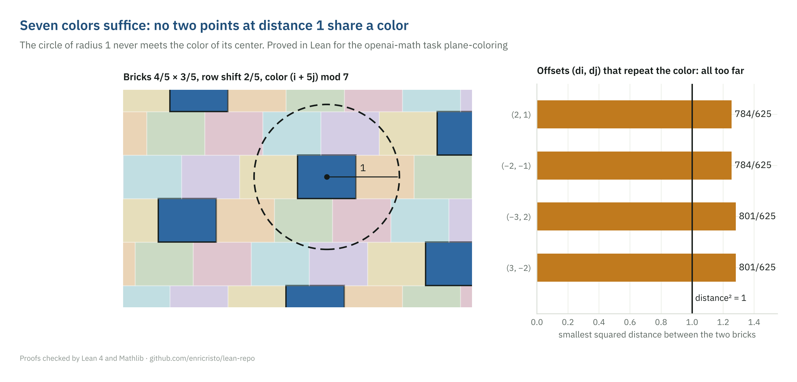
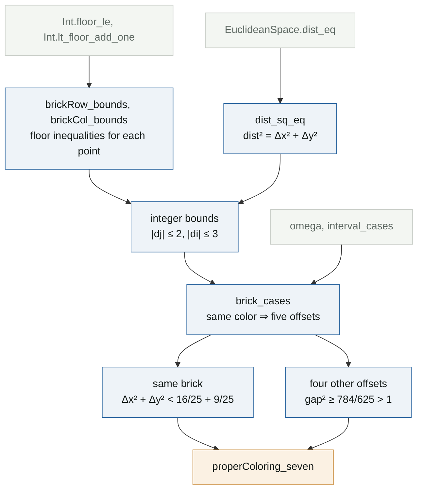

# Seven colors suffice for the plane

**Lean file:** [`Portfolio/Combinatorics/PlaneColoring.lean`](../Portfolio/Combinatorics/PlaneColoring.lean) ·
**Main theorem:** `Portfolio.PlaneColoring.properColoring_seven` ·
**Grader format:** [`challenges/openai-math-plane-coloring/`](../challenges/openai-math-plane-coloring/)



## Statement

There is a coloring of the plane with seven colors such that two points at distance exactly `1` never get the same color:

```lean
def ProperColoring (k : ℕ) : Prop :=
  ∃ c : Plane → Fin k,
    ∀ x y : Plane, dist x y = 1 → c x ≠ c y

theorem properColoring_seven : ProperColoring 7
```

This is the upper bound in the Hadwiger–Nelson problem, χ(ℝ²) ≤ 7 (Isbell, 1950). It is also the task `plane-coloring` of the [openai-math Lean environments](https://huggingface.co/datasets/FineEnvs/openai-math), built from OpenAI's [openai/math](https://github.com/openai/math) release. In that release it belongs to family 158, whose new result is the lower bound: five colors do not suffice. The seven-coloring is the classical companion statement. OpenAI's own proof is public; it was not consulted, and the brick construction below was chosen independently.

## The idea

The classical coloring uses hexagons. Bricks are easier to formalize, because a brick is cut out by two floor functions:

* Row `j` is the strip `3j/5 ≤ y < 3(j+1)/5`.
* Inside row `j`, brick `i` is `4i/5 + 8j/25 ≤ x < 4i/5 + 8j/25 + 4/5`. Each row is shifted `2/5` of a brick to the right of the row below.
* Brick `(i, j)` gets color `(i + 5j) mod 7`.

Two facts finish the proof.

1. **Inside a brick everything is closer than 1.** The brick measures `4/5 × 3/5`, so its diagonal is exactly `√(16/25 + 9/25) = 1`. Because the brick is half-open, two of its points differ by less than `4/5` horizontally and less than `3/5` vertically, so their distance is strictly below `1`.
2. **Same-colored bricks are farther than 1.** If two points are at distance `1`, their rows differ by at most `2` and their bricks by at most `3`. Among those offsets `(di, dj)`, the ones with `di + 5 dj ≡ 0 (mod 7)` are `(0, 0)` and the four in the right panel. Their squared gaps are `784/625` and `801/625`, both larger than `1`.

The left panel shows a unit circle around a point: it only crosses bricks of other colors.

## Proof map



## Reading the Lean proof

**The coloring is three lines.** The brick of a point is two floors, and the color is a remainder:

```lean
def brickRow (p : Plane) : ℤ := ⌊5 * p 1 / 3⌋
def brickCol (p : Plane) : ℤ := ⌊5 * p 0 / 4 - 2 * (brickRow p : ℝ) / 5⌋
def brickColor (p : Plane) : Fin 7 :=
  ⟨((brickCol p + 5 * brickRow p) % 7).toNat, by omega⟩
```

**From reals to integers and back.** The proof starts with `Δx² + Δy² = 1`, so `|Δx|, |Δy| ≤ 1`. Combined with the floor inequalities, this gives real bounds on the integer differences of rows and bricks, which `exact_mod_cast` turns into `|dj| ≤ 2` and `|di| ≤ 3`.

**The case split is finite.** `brick_cases` names the two differences, bounds them, and runs `interval_cases` on both. That leaves 35 offset pairs, and `omega` discards the 30 that do not repeat the color. Calling `omega` directly on the five-way disjunction did not work; the explicit enumeration does.

**Each case is one `nlinarith`.** In every case the floor inequalities give either `|Δx| < 4/5` and `|Δy| < 3/5` (same brick, so the distance is below `1`) or a gap such as `|Δx| > 28/25` (so the distance is above `1`). Both contradict `Δx² + Δy² = 1`.

## Independent checks

[`tests/test_identities.py`](../tests/test_identities.py) recomputes the five offsets and their exact gaps with fractions. It also samples 200,000 random pairs of points at distance `1` and checks that no pair shares a color. [`challenges/check.sh`](../challenges/check.sh) builds the grader-format file against Lean 4.34.1 and Mathlib `d13f23b`, the versions the task pins, and compares every declaration with the official statement.

## References

- J. R. Isbell, unpublished, 1950; see A. Soifer, *The Mathematical Coloring Book*, Springer, 2009.
- A. D. N. J. de Grey, *The chromatic number of the plane is at least 5*, Geombinatorics 28 (2018).
