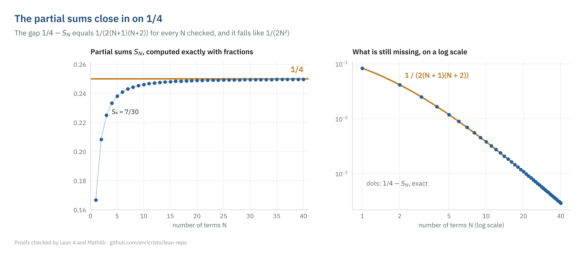
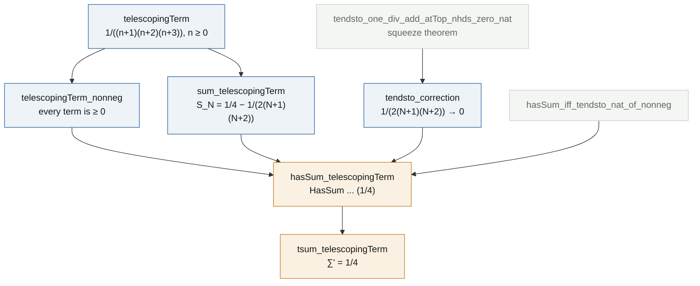

# A telescoping series

**Lean file:** [`Portfolio/Series/Telescoping.lean`](../Portfolio/Series/Telescoping.lean) ·
**Main theorems:** `Portfolio.hasSum_telescopingTerm`, `Portfolio.tsum_telescopingTerm`

## Statement

$$\sum_{n=1}^{\infty} \frac{1}{n(n+1)(n+2)} = \frac{1}{4}.$$

## The idea

**Split each term.** With $g(n) = \frac{1}{n(n+1)}$, partial fractions give

$$\frac{1}{n(n+1)(n+2)} = \frac{1}{2}\bigl(g(n) - g(n+1)\bigr).$$

**Add them up.** Each $-g(n+1)$ cancels the $+g(n+1)$ of the next term, so only the first and the last pieces survive:


In general,

$$S_N = \sum_{n=1}^{N} \frac{1}{n(n+1)(n+2)} = \frac{1}{2}\left(\frac{1}{2} - \frac{1}{(N+1)(N+2)}\right) = \frac{1}{4} - \frac{1}{2(N+1)(N+2)}.$$

**Let $N$ grow.** The correction $\frac{1}{2(N+1)(N+2)}$ goes to $0$, roughly like $\frac{1}{2N^2}$, so $S_N \to \frac{1}{4}$.



## Proof map



## Reading the Lean proof

**Step 1. Shift the index.** Sums over `ℕ` in Lean start at $n = 0$, and $\frac{1}{0 \cdot 1 \cdot 2}$ is not what we want. So the term is written with $n + 1$ in place of $n$:

```lean
noncomputable def telescopingTerm (n : ℕ) : ℝ :=
  1 / (((n : ℝ) + 1) * ((n : ℝ) + 2) * ((n : ℝ) + 3))
```

The `(n : ℝ)` casts the natural number to a real number, so the division is real division and not division in `ℕ`, where $1 / 6 = 0$.

**Step 2. The closed form, by induction.** Instead of formalizing the cancellation, the proof checks the formula for $S_N$ directly:

```lean
theorem sum_telescopingTerm (N : ℕ) :
    ∑ n ∈ range N, telescopingTerm n = 1 / 4 - 1 / (2 * ((N : ℝ) + 1) * ((N : ℝ) + 2)) := by
  induction N with
  | zero => norm_num
  | succ N ih =>
    rw [sum_range_succ, ih, telescopingTerm]
    push_cast
    field_simp
    ring
```

`range N` is $\{0, \dots, N-1\}$, so this sum is $S_N$ with the original indexing. In the inductive step, `sum_range_succ` peels off the last term, `ih` replaces the rest by the formula for $N$, `push_cast` moves the casts inside $(N + 1 : \mathbb{R})$, and `field_simp` with `ring` checks the remaining rational identity. The cancellation picture is still there, hidden in that identity.

**Step 3. The correction goes to 0.** A squeeze between $0$ and $\frac{1}{N+1}$, whose limit Mathlib already knows:

$$0 \le \frac{1}{2(N+1)(N+2)} \le \frac{1}{N+1}.$$

The second inequality reduces to $N + 1 \le 2(N+1)(N+2)$, which `nlinarith` proves.

**Step 4. From partial sums to `HasSum`.** In Mathlib, `HasSum f s` means that the sums over *all finite sets* of indices approach $s$, which is stronger than convergence of $S_N$ (it is unconditional convergence). For nonnegative terms the two notions coincide, and `hasSum_iff_tendsto_nat_of_nonneg` says exactly that. This is the only place where `telescopingTerm_nonneg` is used.

## What the formalization makes explicit

Two things that a written proof leaves implicit become visible. The shift of index, which in a paper is silent, has to be stated. And "the series converges to $1/4$" has two possible meanings; the stronger one, `HasSum`, needs the extra fact that the terms are nonnegative.

## Independent checks

[`tests/test_identities.py`](../tests/test_identities.py) checks the partial fractions, the closed form (with `sympy.summation`), the inductive step with Lean's shifted index, the squeeze bound, the limit, and the values $S_4 = 7/30$ and $S_5 = 5/21$ shown in the figures. [`Test/Axioms.lean`](../Test/Axioms.lean) confirms that the theorem uses only the three standard axioms.
