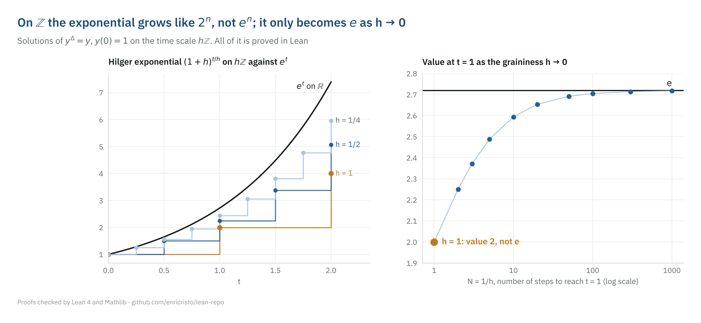
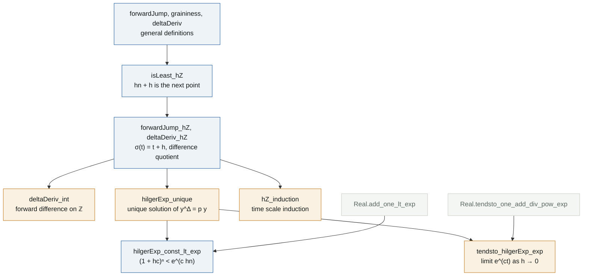

# Time scale calculus on ℤ and hℤ

**Lean file:** [`Portfolio/TimeScales/Integers.lean`](../Portfolio/TimeScales/Integers.lean) ·
**Main theorems:** `Portfolio.deltaDeriv_int`, `Portfolio.hilgerExp_unique`, `Portfolio.tendsto_hilgerExp_exp`, `Portfolio.hZ_induction`



## Why time scales

A time scale is a nonempty closed subset $\mathbb{T} \subseteq \mathbb{R}$ (Hilger, 1988). Calculus on a time scale treats differential equations ($\mathbb{T} = \mathbb{R}$) and difference equations ($\mathbb{T} = \mathbb{Z}$) as two cases of one theory. This was the subject of my undergraduate research project (FAPESP, 2016 to 2018). Mathlib has no time scale theory, so this file sets up the basic objects from scratch and works them out on the discrete time scales $h\mathbb{Z}$, $h > 0$.

## The objects

| Name in Lean | Definition | On $h\mathbb{Z}$ |
|---|---|---|
| `forwardJump` | $\sigma(t) = \inf\{s \in \mathbb{T} : s > t\}$, and $\sigma(t) = t$ if that set is empty | $\sigma(t) = t + h$ |
| `graininess` | $\mu(t) = \sigma(t) - t$ | $\mu = h$ |
| `deltaDeriv` | $f^\Delta(t) = \dfrac{f(\sigma(t)) - f(t)}{\mu(t)}$ at right-scattered points | $\dfrac{f(t+h) - f(t)}{h}$ |
| `hilgerExp` | $e_p(hn, 0) = \prod_{k<n} \bigl(1 + h\,p(hk)\bigr)$ | for constant $p$: $(1 + hp)^n$ |

At right-dense points ($\mu(t) = 0$) the delta derivative is the ordinary derivative, a limit; the file does not formalize it and says so in the docstring of `deltaDeriv`.

## What is proved

1. **Jump and graininess on $h\mathbb{Z}$** (`forwardJump_hZ`, `graininess_hZ`). The key lemma `isLeast_hZ` shows that $hn + h$ is the least element of $h\mathbb{Z}$ to the right of $hn$: if $hm > hn$ with $h > 0$ then $m > n$, so $m \ge n + 1$ because they are integers.
2. **On $\mathbb{Z}$ the delta derivative is the forward difference** (`deltaDeriv_int`): $f^\Delta(n) = f(n+1) - f(n)$.
3. **The Hilger exponential is the unique solution** of $y^\Delta = p\,y$, $y(0) = 1$ (`hilgerExp_dynamic`, `hilgerExp_unique`, and the versions stated with `deltaDeriv`). Uniqueness is an induction: the equation forces $y(n+1) = (1 + h\,p(hn))\,y(n)$.
4. **It is not the exponential.** On $\mathbb{Z}$ with $p = 1$ the solution at time $1$ is $2$, not $e$ (`hilgerExp_one_one_ne_exp`). In general $(1 + hc)^n < e^{c\,hn}$ whenever $hc \ne 0$ (`hilgerExp_const_lt_exp`), from $1 + x < e^x$.
5. **The continuum limit** (`tendsto_hilgerExp_exp`): with $h = t/N$, $(1 + ct/N)^N \to e^{ct}$, so the real exponential comes back as the graininess goes to $0$ (right panel).
6. **Induction on a time scale** (`hZ_induction`): if $P(0)$ holds and $P(t) \Rightarrow P(\sigma(t))$ at right-scattered points, then $P(hn)$ holds for every $n \in \mathbb{N}$.

## Proof map



## Reading the Lean proof

**Defining the jump without choice of a minimum.** The forward jump is an infimum, which may not be attained in a general time scale, so the definition uses `sInf` with a fallback:

```lean
noncomputable def forwardJump (T : Set ℝ) (t : ℝ) : ℝ :=
  if {s ∈ T | t < s}.Nonempty then sInf {s ∈ T | t < s} else t
```

On $h\mathbb{Z}$ the infimum is attained, and `IsLeast.csInf_eq` turns "least element" into "infimum" in one step.

**Uniqueness by induction.** The dynamic equation is rewritten with `div_eq_iff` into $y(n+1) - y(n) = h\,p(hn)\,y(n)$, and `linear_combination` closes the inductive step from that single equation. No real analysis is needed: on a discrete time scale the initial value problem is a recursion.

**The limit.** `tendsto_hilgerExp_exp` is one line on top of Mathlib's `Real.tendsto_one_add_div_pow_exp`, after `hilgerExp_const` rewrites the product as a power.

## Independent checks

[`tests/test_identities.py`](../tests/test_identities.py) builds the solution of $y^\Delta = cy$ step by step in exact rational arithmetic and compares it with $(1 + hc)^n$, and checks that $(1 + 1/N)^N$ starts at $2$, increases and approaches $e$. [`Test/Axioms.lean`](../Test/Axioms.lean) audits the main theorems.

## Reference

M. Bohner and A. Peterson, *Dynamic Equations on Time Scales: An Introduction with Applications*, Birkhäuser, 2001.
